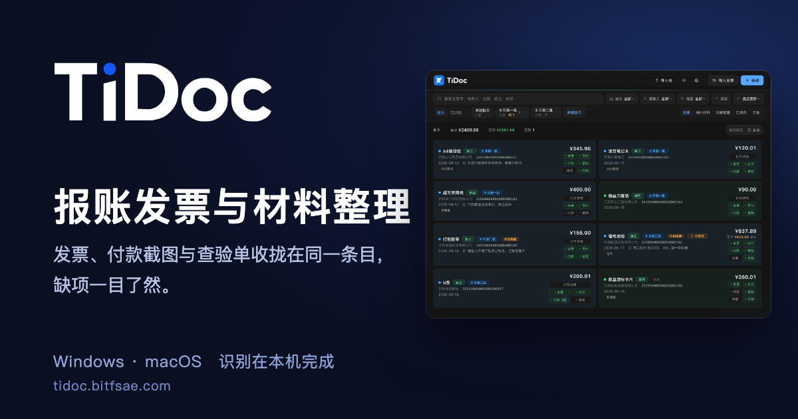

<p align="center">
  <a href="https://tidoc.bitfsae.com"></a>
</p>

# Tidoc

[](https://github.com/totok22/tidoc/actions/workflows/ci.yml)
[](https://github.com/totok22/tidoc/actions/workflows/release.yml)
[](https://github.com/totok22/tidoc/actions/workflows/docs.yml)
[](LICENSE)

> 通用的报账凭证管理与整理工具。

**[文档站 tidoc.bitfsae.com](https://tidoc.bitfsae.com)**　·　[下载安装](https://tidoc.bitfsae.com/start/install.html)　·　[快速入门](https://tidoc.bitfsae.com/start/quickstart.html)　·　[演示视频](https://www.bilibili.com/video/BV1XN3q69EPi/)　·　[常见问题](https://tidoc.bitfsae.com/faq.html)

Tidoc 是一款跨平台桌面程序（Windows、macOS），以一张发票为工作单元，完成发票导入、材料补齐、识别提醒、筛选和批次整理，并导出可交换或打印的报账材料。适合个人、团队和社团使用。

- **整理**：把一张发票和对应付款截图、实物图、查验单放在同一个条目中。
- **核对**：集中查看待补材料、识别提醒、实付差异和阿里云识别结果。
- **协作**：通过 `.tidoc` 绑定包交接完整条目和附件。
- **输出**：生成总览 Excel、附件整理包、材料 PDF，以及报账方案定义的 Word 文档。
- **存储**：业务数据和附件保存在本机，可整体迁移和备份。

## 下载

- [文档站下载页](https://tidoc.bitfsae.com/start/install.html)：直接提供 Windows 和 macOS 最新版安装包的下载按钮。
- [GitHub Releases](https://github.com/totok22/tidoc/releases/latest)：下载最新 Windows 或 macOS 安装包。
- [BITFSAE 官网](https://www.bitfsae.com/)：首页底部选择「报账软件」。

Windows 下载 `tidoc-core-windows-v{version}.exe` 后按提示安装。macOS 下载 `tidoc-core-macos-v{version}.dmg`，打开后把 Tidoc 拖入“应用程序”。

## 使用

使用方法只在文档站维护，这里不重复：

- [快速入门](https://tidoc.bitfsae.com/start/quickstart.html)：五步走完选择方案、导入发票、补齐材料、核对、整理并导出。
- [基本概念](https://tidoc.bitfsae.com/guide/concepts.html)：条目、材料、报账人、标签、报账批次、绑定包、识别提醒等词的含义。
- [使用指南](https://tidoc.bitfsae.com/guide/import.html)：导入、补齐材料、核对、批次、导出打印、报账方案和快捷操作。
- [阿里云 OCR](https://tidoc.bitfsae.com/guide/aliyun-ocr.html)：可选的云识别，开通和配置步骤。
- [设置与数据](https://tidoc.bitfsae.com/guide/settings.html)：数据位置、备份恢复，以及软件在哪些情况下会联网。
- [软件和组件更新](https://tidoc.bitfsae.com/update/)：核心软件、打印导出组件和 OCR 识别组件的更新。

软件内也有入口：主界面右上角的书本图标，以及「设置」底部「关于」里的「文档站」。

## 开发

```bash
git clone https://github.com/totok22/tidoc.git
cd tidoc
python3 -m venv .venv
source .venv/bin/activate          # Windows: .venv\Scripts\activate
pip install -r requirements-dev.txt
pip install -r requirements-print.txt   # 可选：启用打印导出组件
pip install -r requirements-ocr.txt     # 可选：启用阿里云云识别组件

python -m tidoc                    # 启动应用
python -m tidoc --debug            # 打开 WebView 调试
pytest                             # 运行测试
```

从源码运行时优先使用当前工作区的 `tidoc_print` / `tidoc_ocr`；发布版只调用已安装并校验过的独立组件。

文档站（`docs/`，VitePress）本地预览：`cd docs && npm ci && npm run dev`；构建检查：`npm run build`（死链接和缺失截图会使构建失败）。页面标题、描述、站点地图和分享图的约定见 [AGENTS.md](AGENTS.md) 的 Documentation site 一节。首页和概念页的界面截图用 `python -m scripts.docs_screenshots` 重新生成（需要 Chrome 或 Edge 和 Pillow，数据是脚本里的虚构数据，不会读写真实数据目录）。

团队适配包开发入口见[开发手册](docs/adapters/README.md)。

```bash
python -m tidoc.adapter_tools --help
python -m tidoc.adapter_tools validate examples/adapters/generic
```

## 项目结构

```text
tidoc/            核心（pywebview + pypdf + Send2Trash + jsonschema + Pillow + zxing-cpp）
├─ engine/        发票 XML / PDF 解析与金额校验
├─ adapters/      适配包协议、规则、内置包加载和方案服务
├─ builtin_adapters/  内置报账方案（通用、BITFSAE）
├─ adapter_tools/ 适配包命令行工具
├─ db/            SQLite、附件仓库、报账人、条目和批次
├─ services/      导入、汇总、绑定包、导出、打印适配和更新
├─ web/           HTML/CSS/JS 前端
├─ api.py         PyWebView JS ↔ Python 桥
└─ app.py         应用入口
tidoc_print/      打印导出组件（可选，含 Word / PDF 重依赖）
tidoc_ocr/        OCR 识别组件（可选，含阿里云 SDK，只在用户点击时联网）
schemas/          团队适配包 JSON Schema
examples/         团队适配包示例
docs/             文档站（VitePress）：使用文档、开发文档和截图
scripts/          构建、版本号注入和打包入口
packaging/        Windows 安装器脚本
icon/             方形母版及 Windows 圆角 / macOS 方形平台图标
tests/            pytest 测试
.github/          CI、文档构建和发布流程
```

## 状态

### 已可用

- **识别与核对**：发票 XML / PDF 解析，支持品名换行、跨页续接、免税与不征税明细、同品名折扣合并；按票面「价税合计」取总额，并核对不含税合计加税额、大写金额、两种读取方式的结果和 18 位信用代码校验位；XML 与 PDF 交叉核对，票面核对依据随条目保存；付款截图金额识别（实验性）、识别提醒、在线查验辅助；可选阿里云 OCR（软件内填密钥，点击「云识别」时才联网，识别结果可与本地结果比对后采用）。
- **取票二维码导入**：拖入或粘贴商家给的取票二维码图片，联网下载发票 PDF 和 XML（只在放入二维码时联网；已在深圳、广东、湖北的链接上验证，支持取消和失败重试；平台改版会失效，可手工导入）。
- **条目与材料**：一张发票对应一个条目，可补付款截图、查验单和实物图，支持备注、标签、批量选择、右键菜单和键盘导航；报账抬头、税号和材料要求可配置，首次可选通用方案或含北理工与教育基金会抬头的 BITFSAE 方案。
- **筛选与批次**：按材料状态、识别提醒和实付差异筛选；条目归属单一报账批次（在办 / 已归档）；导入时选择批次，弹窗内可新建报账人。
- **界面**：浅色、深色和跟随系统；长列表只排版视口附近的卡片。
- **交接**：`.tidoc` 绑定包携带完整条目和附件，导入时检测包内文件是否被手工改动（只能发现改动，不能防伪造）；Windows / macOS 关联 `.tidoc` 文件，重复启动会激活已有窗口。
- **输出**：总览 Excel、附件整理包；安装「打印导出组件」后可生成材料 PDF 和 Word 文档。
- **更新**：核心软件与两个可选组件独立更新，有 SHA256 校验和修复入口；核心支持后台下载与断点续传；可选测试版通道，默认关闭；发票识别方法更新后提示重新识别已有发票，可关闭提醒。
- **团队适配包**：团队用 JSON 和 Word 模板定义自己的抬头、材料要求和输出，附命令行工具、示例和[开发手册](docs/adapters/README.md)。
- **文档站**：[tidoc.bitfsae.com](https://tidoc.bitfsae.com)（VitePress，`docs/`），软件内有入口。

### 尚未完成

- [ ] 团队适配包的逐项人工验收：真实应用界面、XML 单独扫描导入、兼容组合和旧数据升级。
- [ ] Windows / macOS 上 Word、WPS 打开导出文档的版式核对，以及完整的跨平台发布检查。

自动化测试覆盖解析、数据库、导出和适配包。部分解析回归需要真实发票样本，仓库不附带，设置环境变量 `TIDOC_INVOICE_SAMPLES` 指向样本目录即可运行；没有样本时这些测试会跳过。

设计细节见 [DESIGN.md](DESIGN.md)，变更记录见 [CHANGELOG.md](CHANGELOG.md)，更新发布流程见 [docs/UPDATE.md](docs/UPDATE.md)。

## 参与贡献

欢迎提交 Issue 和 Pull Request。请先阅读 [CONTRIBUTING.md](CONTRIBUTING.md)。

## 许可证

[MIT](LICENSE)
